<p><a href="https://app.grove.x-arc.ai"><picture><source media="(prefers-color-scheme: dark)" srcset="docs/readme/hero-top-dark.svg"></picture></a><a href="https://app.grove.x-arc.ai"><picture><source media="(prefers-color-scheme: dark)" srcset="docs/readme/hero-open-dark.svg">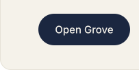</picture></a><a href="VIDEO_LINK"><picture><source media="(prefers-color-scheme: dark)" srcset="docs/readme/hero-demo-dark.svg">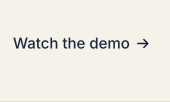</picture></a><a href="https://app.grove.x-arc.ai"><picture><source media="(prefers-color-scheme: dark)" srcset="docs/readme/hero-rest-dark.svg">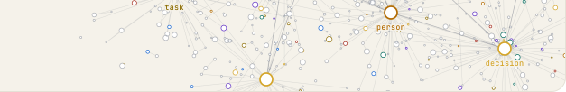</picture></a></p>

<p>
<picture>
  <source media="(prefers-color-scheme: dark)" srcset="docs/readme/sec-why-dark.svg">
  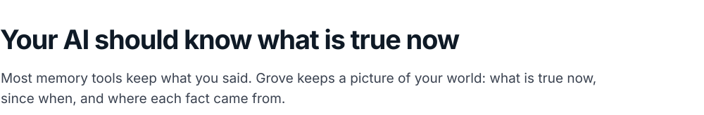
</picture>
</p>

You explain your work to your AI again and again, and it still mixes last month's plan with today's. The memory tools we tried kept failing in the same three ways: their fixed set of node and relationship types could not keep up with a changing world, they kept a fact that holds for an hour like one that holds for good, and they could not tell something said from something done.

Grove keeps a living representation of your world instead. The kinds of things in it grow with you, every fact carries its own clocks and its source, and one writer checks every change against the graph's rules. Your AI reads it through MCP, so every conversation starts from what is true now.

<p>
<picture>
  <source media="(prefers-color-scheme: dark)" srcset="docs/readme/sec-world-dark.svg">
  
</picture>
</p>

<p>
<picture>
  <source media="(prefers-color-scheme: dark)" srcset="docs/readme/grove-today-dark.webp">
  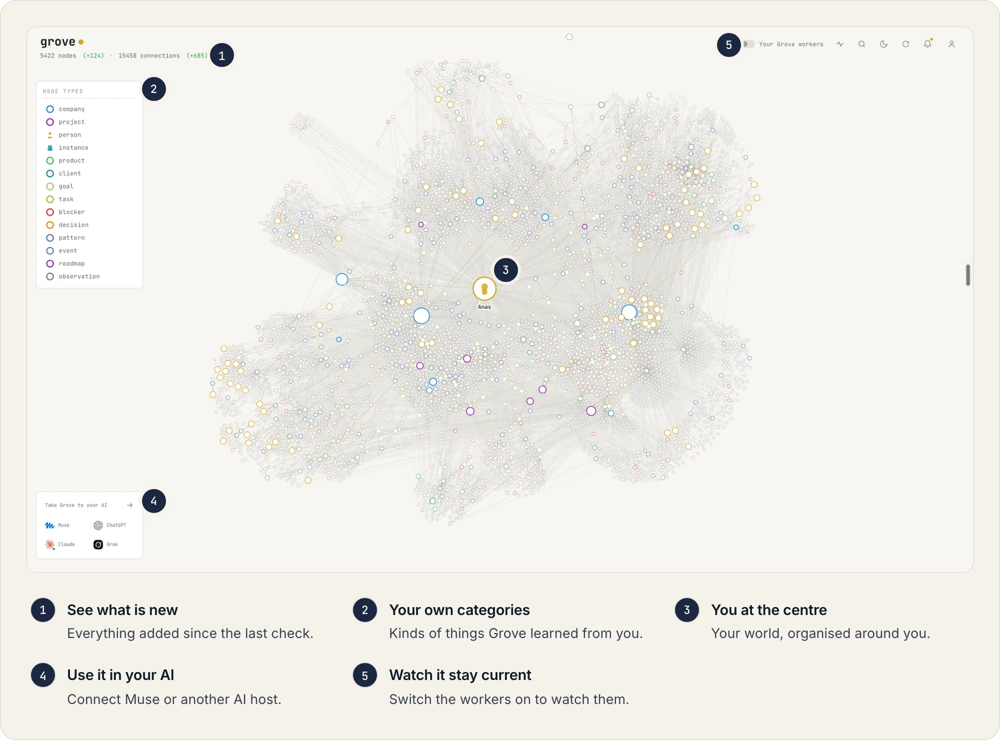
</picture>
</p>

**What you get:** One map of your world that you can open, explore and trust: the people, projects, decisions and events in it, how they connect, and what was added since the last check. This one is our own Grove, the one behind our AI PA, with 5,422 items and 15,458 links.

**How it works:** You bring your conversations in through onboarding, which guides you through exporting them from ChatGPT or Claude. Grove screens each file in code, dropping credentials, card numbers, codes, reset links and other people's contact details before anything is stored, without calling a model (`server/grove/ingest/`, `server/grove/screening/`). Items and links live in Neo4j and are read through queries scoped to one world (`server/grove/store/`, `server/grove/views/`). The map and its worker renderer predate the hackathon, as [HACKATHON.md](HACKATHON.md) records, and in the app the prepared account shows an invented world on this same map.

<p>
<picture>
  <source media="(prefers-color-scheme: dark)" srcset="docs/readme/sec-fact-dark.svg">
  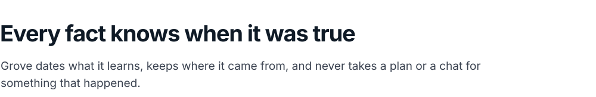
</picture>
</p>

<p>
<picture>
  <source media="(prefers-color-scheme: dark)" srcset="docs/readme/fig-fact-dark.svg">
  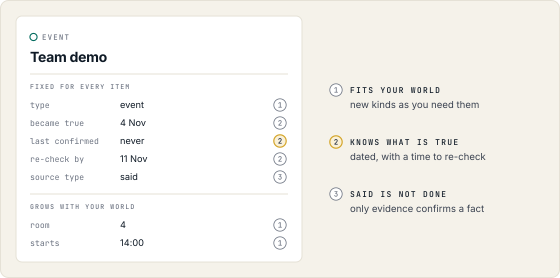
</picture>
</p>

**What you get:** When your AI asks Grove about anything in your world, it learns whether that fact is still true, when it was last confirmed, and whether someone only said it or it really happened. You see the same in every item's panel.

**How it works:** Each of these lives in one place in the code, and one writer enforces them all.

| What you get | How Grove does it, and where in the code |
|---|---|
| **Fits your world** | Every item has a small fixed core and any other field your world needs. A new word for a kind, a link or a field starts out provisional. Spark 1.3 judges it first and Glimmer judges it again without seeing that verdict. If both find that it means a word Grove already has, it becomes an alias of that word, and a provisional word becomes canonical once three distinct episodes use it.<br>`server/grove/writer/ontology.py` |
| **Knows what is true** | `became_true` records when a fact became true, `last_confirmed` when Grove last confirmed it, and `recheck_by` when to check it again. Only `verify` moves `last_confirmed`: an update, a status change or the passing of time leaves it as it was.<br>`server/grove/writer/verify.py` |
| **Said is not done** | Every fact keeps its source type: planned, said, reported done or confirmed. Grove derives it in code from where a statement came from, never from what a caller claims. Something said in a chat stays said or reported done, so it never confirms a fact, and a done needs a confirming record from a source that can prove it.<br>`server/grove/writer/source_types.py` |
| **Nothing lands unchecked** | The writer is the only way into storage. Models and agents propose, and the writer checks every operation in code, commits a batch whole or not at all, never overwrites a correction, and answers with a receipt.<br>`server/grove/writer/` |

New words in your world are checked twice, by two different Meta models, before Grove adds them to its vocabulary.

<p>
<picture>
  <source media="(prefers-color-scheme: dark)" srcset="docs/readme/fig-judges-dark.svg">
  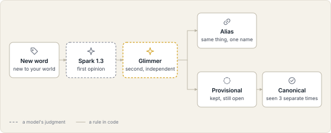
</picture>
</p>

<p>
<picture>
  <source media="(prefers-color-scheme: dark)" srcset="docs/readme/sec-workers-dark.svg">
  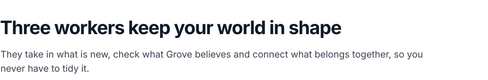
</picture>
</p>

<p>
<picture>
  <source media="(prefers-color-scheme: dark)" srcset="docs/readme/grove-workers-dark.webp">
  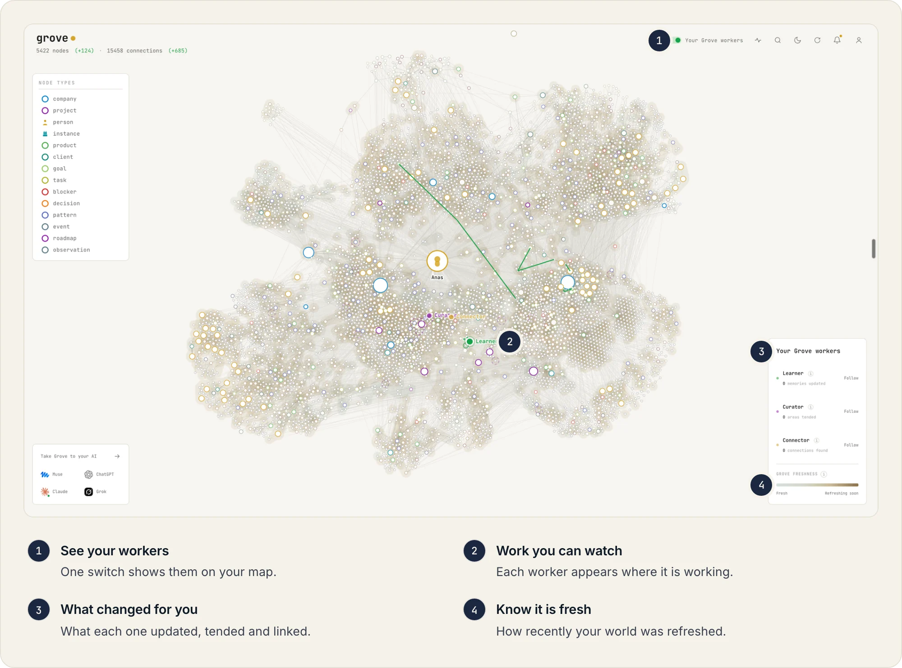
</picture>
</p>

**What you get:** A world that stays in shape without you tidying it. The Learner takes in what is new, the Curator checks what Grove believes against its sources, and the Connector links what belongs together. Switch them on to watch them work, and see what each one changed for you.

**How it works:** The workers are OpenCode agents on Muse Spark 1.3. None of them can write: they read and propose through the `brain` command line, and the writer decides what lands. Their instructions are in `runner/agents/` and the loop that runs them is in `server/grove/runner/`. The screenshot shows our own Grove; in the deployed app, the workers are built and not switched on yet.

<p>
<picture>
  <source media="(prefers-color-scheme: dark)" srcset="docs/readme/sec-ai-dark.svg">
  
</picture>
</p>

**What you get:** Your AI starts every conversation from your world instead of from zero. Connect Muse once, and it answers with the evidence behind each answer. What you ask it to remember goes back into Grove as said, until a source of truth shows it happened.

**Try it with Muse:** In this release, recall and store work on a prepared account that holds an invented world, and the team gives judges access to it. In Muse, add `https://app.grove.x-arc.ai/mcp` as a remote MCP connection, sign in, approve on Grove's consent page, and ask:

- Where and when is the Cedar demo?
- What did we decide for Willow Dapple Cove's kitchen pilot?
- What do we need to check when the seed trays arrive at Moss Bramble Reach?

<details>
<summary>Check it from Muse Code instead</summary>

<br>

Muse Code needs its own `META_API_KEY`. Use a new, empty test directory as the child process's HOME, with its XDG config, data, state and cache directories inside it, so that no existing settings, conversations or credentials are used. Set `MUSE_NO_AUTO_UPDATE=1` and create `.config/muse/settings.json` inside the test directory:

```json
{
  "schema_version": 1,
  "mcpServers": {
    "grove": {
      "type": "http",
      "url": "https://app.grove.x-arc.ai/mcp"
    }
  }
}
```

Run `muse mcp login grove --headless`, sign in with the prepared account and select **Approve**. Treat the returned loopback URL as a credential. Then ask:

```sh
muse exec --model muse-spark-1.3 --no-foreign-personal-context --contributor-mode off "Where and when is the Cedar demo?"
```

Approve only `recall`, and finish with `muse mcp logout grove`. This settings shape was tested with Muse Code 1.4.14.

</details>

**How it works:** The MCP server (`server/grove/mcp/`) sits behind an OAuth 2.1 server (`server/grove/oauth/`) with PKCE, dynamic client registration, refresh, revocation and a consent page you approve. A host gets two tools, `recall` and `store`. Recall returns evidence, never instructions, and a store goes through the same writer as everything else. Grove refuses a batch that mixes reading and writing.

<p>
<picture>
  <source media="(prefers-color-scheme: dark)" srcset="docs/readme/sec-compare-dark.svg">
  
</picture>
</p>

<p>
<picture>
  <source media="(prefers-color-scheme: dark)" srcset="docs/readme/fig-compare-dark.svg">
  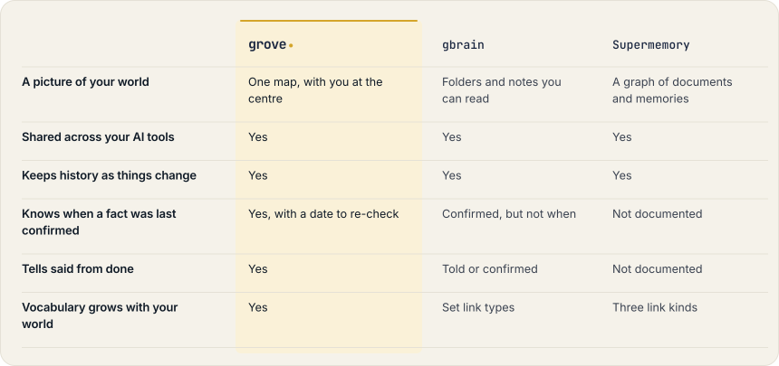
</picture>
</p>

All three share memory across your AI tools and keep its history. Grove goes further: it keeps one map of your whole world, and every fact knows when it was last confirmed and whether it was said or done. Grove's column describes this repository; what is live today is listed below.

Sources, checked October 30 to November 5, 2026. gbrain: [memory](https://gbrain.io/docs/workspace/memory), [setup](https://github.com/garrytan/gbrain/blob/3654a7753313cd4946e3db435760ace41e050046/docs/guides/setup.md), [belief ledger](https://github.com/garrytan/gbrain/blob/3654a7753313cd4946e3db435760ace41e050046/docs/architecture/key-files/belief-ledger.md), [trust levels](https://github.com/garrytan/gbrain/blob/3654a7753313cd4946e3db435760ace41e050046/docs/guides/memory-trust.md), [typed links](https://github.com/garrytan/gbrain/blob/3654a7753313cd4946e3db435760ace41e050046/docs/guides/temporal-edges.md) and [schema](https://github.com/garrytan/gbrain/blob/master/src/schema.sql). Supermemory: [MCP](https://supermemory.ai/docs/supermemory-mcp/mcp) and [graph memory](https://supermemory.ai/docs/concepts/graph-memory).

<p>
<picture>
  <source media="(prefers-color-scheme: dark)" srcset="docs/readme/sec-hood-dark.svg">
  
</picture>
</p>

<p>
<picture>
  <source media="(prefers-color-scheme: dark)" srcset="docs/readme/fig-flow-dark.svg">
  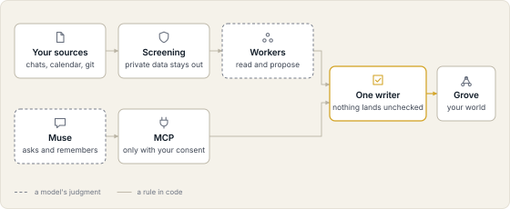
</picture>
</p>

Grove is built in three layers. Ingestion brings your sources in and screens them in code. The brain proposes changes, and one writer decides which of them land. Access gives the app and your AI host a scoped view of the result. Grove runs on Python 3.12 and FastAPI, with Neo4j Community as the store, OpenCode for the workers, plain JavaScript for the app and Modal for Glimmer.

#### Meta's models in Grove

Every model call goes through one layer, `server/grove/models/`. It picks the model and the effort from the job, applies each world's daily budget and records the call, with its tokens and its cost, in `model_calls`. An agent cannot raise its own effort.

| Job | Model | Effort |
|---|---|---|
| Extracting facts from new input | Muse Spark 1.3 | minimal |
| Checking a claim against its sources | Muse Spark 1.3 | low, high when sources conflict |
| Judging a proposed word first | Muse Spark 1.3 | low |
| Explaining what a change breaks | Muse Spark 1.3 | low |
| The Learner's and the Curator's passes | Muse Spark 1.3 | low |
| Consolidation and the Connector's passes | Muse Spark 1.3 | high |
| Triage of new input and reading images | Muse Glimmer | low |
| The second opinion | Muse Glimmer | medium |
| Voice notes | Muse Voice Transcribe 1.0 | |

Spark 1.3 runs through the Meta Model API, with prompt caching and strict JSON output. Muse Glimmer 30B, Meta's open-weight model, runs on our own deployment on Modal, with vLLM on one H100 or A100 that scales to zero after one idle minute. It gives Grove a judge that can disagree with Spark. When Glimmer cannot be reached, a second Spark call stands in and its verdict is recorded as correlated, so the record stays honest about how independent the two opinions were. Muse is where Grove gets used.

<p>
<picture>
  <source media="(prefers-color-scheme: dark)" srcset="docs/readme/sec-status-dark.svg">
  
</picture>
</p>

As of November 4, 2026, the deployed service runs the parts marked as running. The rest is in this repository with its tests, and is not switched on yet.

| What you can do | Today |
|---|---|
| Sign in with Google or an email code |  Runs |
| Bring in your ChatGPT and Claude conversations, screened in code |  Runs. Each kept part enters the Learner queue, and a Learner pass adds what it finds to your map. |
| Explore your map and every item's panel |  Runs |
| Connect Muse or another AI host, with your consent |  Runs |
| Ask your AI and have it remember (`recall` and `store`) |  Runs on the prepared account |
| Workers that keep your world current |  Built, not switched on yet |
| New words checked by Spark 1.3 and Glimmer |  Built, not switched on yet |
| Calendar and Git as sources |  Built, not switched on yet |
| Notes, files and voice notes |  Built, not switched on yet |

Dated evidence for each part is in [docs/submission-status.md](docs/submission-status.md).

<p>
<picture>
  <source media="(prefers-color-scheme: dark)" srcset="docs/readme/sec-build-dark.svg">
  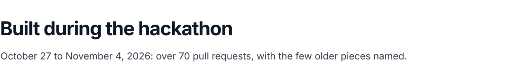
</picture>
</p>

The Meta Global AI Developer Hackathon opened with its kickoff on October 26, 2026, and its building period ran from October 27 to November 4. This repository was built in that period, and more than 70 pull requests were merged into it by November 4. [HACKATHON.md](HACKATHON.md) records the event's pull requests with their dates, and names the few pieces that come from before the event: the graph view, the worker renderer and the export-guide screens from our earlier Grove simulation, and the vendored font CSS.

#### Run it locally

You need Python 3.12, `uv` and Docker Compose. The web client is plain JavaScript with a standard-library Python build, so there is no npm install.

```sh
uv sync --project server --frozen
```

Load `NEO4J_AUTH` into your shell as `neo4j/<your-password>`, without putting the value in a command, a tracked file or a log. The Compose file pins Neo4j Community and binds Bolt to `127.0.0.1:57687`.

```sh
: "${NEO4J_AUTH:?Load the development database credential securely first}"
docker compose -f docker-compose.dev.yml up -d
```

Once the database reports healthy, build the pages, apply the migrations and start the API:

```sh
python3 web/build.py
cd server
uv run python -m grove.writer.migrate
GROVE_WEB_DIST=../web/dist GROVE_PUBLIC_BASE_URL=http://127.0.0.1:8000 \
  uv run uvicorn --factory grove.api.app:create_app --host 127.0.0.1 --port 8000
```

Open `http://127.0.0.1:8000`. This starts the API and the pages, not the model gateway or the workers. Email sign-in needs `RESEND_API_KEY` and `MAIL_FROM`, and Google sign-in needs `GROVE_GOOGLE_OAUTH_FILE` with a registered callback. The [sign-in contract](docs/signin.md), [runner guide](docs/runner.md) and [deployment guide](docs/deploy.md) cover those services.

The document checks need no database, provider or model:

```sh
uv run --project server python -m pytest server/tests/submission -q
```

#### Repository map

| Path | What it holds |
|---|---|
| `server/grove/api/` | HTTP routes, browser sessions, OAuth, upload and the views |
| `server/grove/writer/` | The only way into storage: validated changes, durable requests, history and receipts |
| `server/grove/store/` | Scoped reads, the schema catalogue and the database connection |
| `server/grove/ontology/` | The path from a proposed word to a judged batch |
| `server/grove/models/` | The metered model-call layer and the gateway for the workers |
| `server/grove/mcp/`, `server/grove/oauth/` | The MCP transport, its tools and the OAuth 2.1 server |
| `server/grove/ingest/`, `server/grove/screening/` | Source parsing, retention and screening |
| `runner/` | The workers' agents and their configuration |
| `server/migrations/` | Append-only migrations |
| `server/tests/` | About 4,800 test functions |
| `web/` | The app's pages and their build |
| `deploy/`, `docs/` | Deployment procedures, component contracts and release evidence |

#### Where this came from

Grove began as the memory behind the AI PA we use at X-Arc. For months it kept track of how the company runs, and it became too useful to keep to ourselves. The hackathon was our moment to rebuild it properly, as a product anyone can use, on Meta's models.

#### License

[Apache-2.0](LICENSE)
