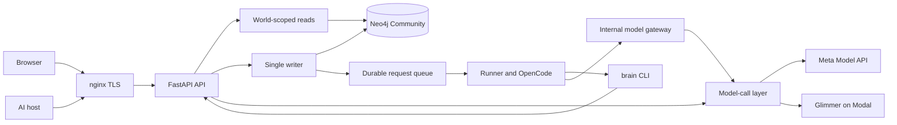

# Architecture

Source baseline: `c145cf8b450f3ae7ab43989cf07969ee5b493057`, recorded on 2026-11-04 at 19:04 UTC.
The recorded API serves PR #60, `564cc99b9c8a718f163503cc23227a8f2908fcd1`.
The runner and gateway remain on `266d0cf7429eb2ca51bd5bebf9f5785acbcd7b2e`.
Request18 remains FAILED. Request19 closure has no completed receipt in this snapshot.
These are distinct revisions and outcomes. [Submission status](submission-status.md) records evidence limits.

## Component map

This map shows component relationships. It does not establish complete runtime acceptance.
The browser uses plain JavaScript. `web/build.py` generates pages and assets in `web/dist`.
The same build generates the [data-flow statement](data-flow.md) from the privacy source.

## Storage, time, and changes

Neo4j Community stores typed items, links, evidence, and time fields. World predicates in
`server/grove/store/query.py` form part of the isolation boundary. Only the writer layer opens
write transactions. It validates changes and produces receipts from post-commit reads.
A queued request does not mean a saved result.

Corrections preserve prior values. History and restore use the D3 writer contract. Truth-clock
checks distinguish source timestamps, scheduled events, and verified claims. A source timestamp
does not prove an event occurred. The ontology floor, bounded consequences, belief transitions,
extraction, and cleanup each have source components with their own evidence and open limits.

Read the [store map](store-map.md), [writer API](../server/grove/writer/README.md),
[consequences](cascade.md), [beliefs](beliefs.md), and [extraction](extraction.md).
Full D14 physical/runtime restore acceptance and complete general D7 reads remain open.
Published authority and worker components do not by themselves activate those services.

## Browser, identity, and MCP

Browser sessions bind access to an account's world. Google and email-code sign-in use real
authentication. OAuth provides scoped grants, PKCE, dynamic registration, consent, refresh,
and revocation. The anonymous root redirects to `/login`; that route also exposes signup.
See [sign-in](signin.md) and [hosts](hosts.md).

The general registry still has `DEFAULT_TOOLS = ()`. A separate authority-checked pair exposes
restricted Cedar `store` and `recall` for prepared synthetic data. The rehearsal uses recall
only. General store/read acceptance does not follow from this pair. Current owner login and
Muse acceptance remain **NOT RUN**. The source refuses mixed read/write MCP batches.

The browser contains the approved pre-event presentation assets and subsequent API integration.
Worker status has a [recorded API contract](worker-activity.md). A toggle or status record does
not prove complete worker execution. The UI repair in PR #60 is published source in this baseline.
The recorded API serves PR #60; this does not establish owner or full UI acceptance.
Its source checks do not prove deployed acceptance. Full responsive, control, and first-load
transfer acceptance remain open.
Disabled or disclosed controls still require implementation where the feature scope requires them.

## Sources and materials

PR #58 changes ordinary authenticated ChatGPT/Claude JSON and ZIP uploads to a fresh mandatory
screening policy. It removes the exact-Lumen-only fallback without bypassing screening.
It is present in this source baseline and the recorded PR60 API.
An accepted upload retains screened Sources, Episodes, and receipts; it does not create graph
Items or links. The prepared graph is a separate dataset. See [ingest](ingest.md).

Calendar and Git have read-only connector source and revocation rules. Actual configured
provider consent remains separate acceptance. [Pipedream](pipedream.md) imports no content.
PR #59 adds corrected account status, public catalog metadata, and confirmed account-scoped
disconnection. That source is in the recorded PR60 API. A connected badge proves no import.

Internal document, WhatsApp, image, and audio parsers exist. PR #61 merged materials as
`0682eb201ad0ccfb8a8a9d074d07759ec8eb31a1`, from source `d17151421e027a4fe19b269a9f06cf6dcd17fe33`.
This published source adds screened storage, immutable revisions, and notes with ordinary Requests.
Files report `held_provenance` and create no file Request. Materials are not deployed in the recorded PR60 API.
Migration `0019_material_revisions.cypher`, a canonical external ledger, and coordinated
API/runner source require a future materials release.
Typed-file graph admission remains separate work. Parser tests do not prove durable retention,
live extraction, or complete material acceptance. See [media](ingest-media.md),
[WhatsApp](ingest-whatsapp.md), and [audio](ingest-audio.md).

## Models and operations

The runner selects work and issues a world-bound token to OpenCode. Its agents use the `brain`
CLI rather than direct database access. Command validation and OpenCode permissions restrict
execution. nginx excludes the internal API from public access. See [runner](runner.md).

The model-call layer records provider usage and applies job policies. Spark uses Meta Responses
for direct calls; the OpenCode gateway uses Chat Completions. Glimmer runs on Modal.
The gateway enforces a daily ceiling; concurrent calls can exceed it before usage records arrive.
Modal idle costs and lost usage rows after process failure remain measurement limits.
See [models](models.md).

[Deployment](deploy.md) uses separate API, runner, and gateway services. Backups use offline
Neo4j dumps. The Request18 diagnosis at 2026-11-04 18:54:49 UTC confirmed all 20 runtime
paths and five policy controls. Four `web/checks` paths were correctly excluded from the image.
The wrapper expected those absent paths, so Request18 remains FAILED. Root separately recorded
`/healthz` HTTP 200 at exact PR60. The old `deployed.sha` value from Request17 is not the served API.
Request19 preparation is complete, and Root later granted one closure attempt; this snapshot
contains no completed closure receipt. PR #63 changes the source helper, not the served application.
Health and synthetic backend results do not certify owner login, Muse, live provider consent,
complete worker behavior, or complete erasure. No new runtime checks ran for this document refresh.

## Browser material boundary

Browser material routes require the session, same Origin and `X-Grove-Action: materials`.
Create and edit require a UUID `Idempotency-Key`. WorldWriter checks the current session and
persisted demo designation before the first write. A private ledger lock precedes the World
lock. Every material read and write refuses an external intent that lacks its matching committed
ForgetLedger row. Recovery must replay that intent before the material becomes readable again.
Material note Requests use the same canonical check before a claim, Learner input, proposal,
or successful no-op. The external lock remains held through the protected read or World
transaction. A pending intent returns unavailable and preserves the Request for recovery.
An ordinary source-span erasure retains the other title/body Sources and the revision order.
Material counts describe the remaining body messages. Snapshot validation accepts erased
Source references with empty content and verifies those counts before and after ledger replay.
Only a material-family tombstone marks every revision deleted.
Files remain source-only. Notes use the existing Learner pass and writer, never a synchronous
model call in an HTTP handler. Whole-brain reset must include material revisions, title/body
Sources, note Requests/Episodes and the ordinary derived graph state.

The private `GROVE_FORGET_LEDGER_DIR` must preserve exact canonical equality between external
intents and committed ForgetLedger rows. Do not remove or replace the ledger to bypass recovery.
The Learner start preflight uses `requests._DUE`. Saved Requests, future retries, and active
leases do not block unrelated due nonmaterial work. When a material Request becomes due,
pending deletion still refuses the pass. Exact claim, input, apply, and finish guards retain
the canonical check and lock lifetime regardless of due status.

PPTX static layout/master text refuses with HTTP 422 before retention. Placeholder defaults
and empty templates remain supported. The parser does not silently discard static template text.
Original component proof: 225 tests. Final repair proof: 70 tests and seven source checks.
The final independent F4 source review is PASS at the recorded source head, not full R4.
Earlier failures and the lock refusal remain preserved. No materials runtime acceptance is claimed.
