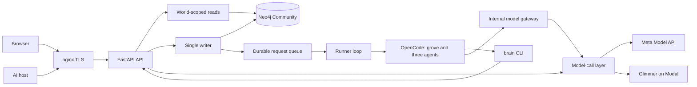

# Architecture

This document describes the merged implementation at
`57da012f05eecfd0641773e12e4f3a0912bff5cb`, checked on 2026-11-03. It distinguishes implemented
components from pending integrations. The [release status](submission-status.md) records the public
revision and the acceptance gaps. The full approved feature scope remains required.

## Data paths

The diagram shows component relationships, not public acceptance. Public `store` and `recall`,
real export uploads, and the complete agent prompts still require their feature integrations.

## Storage and writes

Neo4j Community is the only database. The store map translates the design's tables into labels,
relationships, and properties. `server/migrations/` contains numbered, idempotent schema changes.
`server/grove/store/query.py` supplies the world-scoped read layer. A shared database makes these
world predicates part of the isolation boundary.

Only `server/grove/writer/` opens write transactions. The writer validates typed items, links,
evidence, and registry declarations. A committed batch produces a receipt from a subsequent read.
The request queue records idempotency, leases, failures, and saved results. A caller's acknowledgement
is distinct from a committed receipt. See [the writer API](../server/grove/writer/README.md) and
[the store map](store-map.md).

The schema and initial standing logic contain time and source fields. Complete truth-clock
verification, correction and restore behavior remain under the open feature PRs. The ontology floor
adds provisional vocabulary, two recorded judgments, reuse-first decisions, and a change log.
Ontology merge, split, rename, retirement, and undo remain outside that floor.

## Browser and OAuth boundaries

The browser uses session-protected routes. Google and email-code sign-in create or resume an
account's world and own item. OAuth issues scoped tokens for a host and world. PKCE, dynamic client
registration, metadata discovery, consent, refresh, and revoke live in the OAuth modules.

`server/grove/api/mcp.py` implements the MCP HTTP boundary. `server/grove/mcp/transport.py`
handles JSON-RPC. At this snapshot, `server/grove/mcp/tools.py` sets `DEFAULT_TOOLS = ()`.
The transport exists, but the public tool implementations do not. Local OAuth tests use injected
synthetic tools. They do not prove a public `recall` or `store` result. See [hosts](hosts.md).

The web client comes from the pre-event simulation, with initial graph, node, schema, health,
sign-in, and map-position integration. Other source, account, and worker views retain simulation
state until their feature slices replace it. Full history on both time axes, upload receipts,
questions, beliefs, and replay require later integrations. See [views](views.md).

## Agent execution

The runner is a separate process. It selects due work, gives one pass a world-bound token, and
starts OpenCode. The primary `grove` agent delegates to `learner`, `curator`, or `connector`.
The `brain` CLI sends requests to the API; it has no direct database access. A shell validator and
OpenCode permissions restrict agent commands. nginx excludes `/v1/internal/` from public access.

The queue and runner implement leases, watchdogs, retries, and receipt tracking. The initial
prompts demonstrate the infrastructure. The full extraction, verification, cleanup, and belief
contracts remain work for their feature slices. [Runner documentation](runner.md) records the
commands, token boundaries, and known gaps. The latest runner code is merged, but its public
deployment remains pending after a failed network transition and rollback.

## Models and source content

`server/grove/models/` selects a model and effort by job, applies the job's budget policy, calls
the provider, and records usage. Spark uses Meta's Responses API for direct responses; the
OpenCode gateway uses Chat Completions. Voice Transcribe has its own audio path. Glimmer runs on
Modal. The [model documentation](models.md) records the live synthetic probes and protocol limits.

Every gateway job stops at the daily ceiling. Some direct jobs continue by policy, including
triage, extraction, and transcription. Concurrent calls can exceed a ceiling before their costs
are recorded. Modal cold-start and idle costs are absent from `model_calls`, so that table is not
a complete infrastructure bill. A process failure between a response and its record can lose a row.

Source screening and labelled data blocks separate imported text from agent instructions. The
planned upload path must screen content before persistence. This boundary requires connector and
agent integration tests; a screening library alone does not prove a complete import. The
[data-flow page](data-flow.md) records implemented and planned flows. Complete forgetting across
all text, history, and restored backups remains pending.

## Verification and operations

`Validate` runs the product checks against a Neo4j service. Relevant suites include
`server/tests/writer/`, `server/tests/hosts/`, `server/tests/auth/`, `server/tests/models/`,
`server/tests/runner/`, and `server/tests/e2e/`. Browser and live-model tests are separate lane
exercises. Document checks in `server/tests/submission/` cannot certify public behavior.

The deployment uses nginx, a FastAPI API, Neo4j, and separate runner/gateway services. Backups use
an offline database dump. [Deployment documentation](deploy.md) states the process. `/healthz`
reports liveness, store access, and the served revision; it does not measure memory truth or
feature completion. The release requires fresh browser and isolated Muse Code evidence at the
final revision, plus the exact candidate's identity and secret scans.
