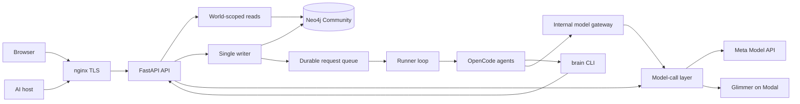

# Architecture

Source snapshot: `6346a9fc7c6c9b8119a9e7310cb93944f2fb1afe`, checked on 2026-11-04. Public build: `cac4b95cbc7ce5284c04fcb684ebb2f115162144`.
These are different revisions. [Submission status](submission-status.md) separates source,
deployment receipts, and actual acceptance. The complete feature scope remains required.

## Data paths

The diagram describes component relationships. It does not establish public or full feature acceptance.

## Storage, time and writes

Neo4j Community is the only database. The [store map](store-map.md) defines labels, relationships,
properties, and idempotent migrations. World predicates in `server/grove/store/query.py` form part
of the isolation boundary. Only `server/grove/writer/` opens write transactions. The writer checks
typed items, links, evidence, and registry declarations, then produces a receipt from a post-commit read.
The queue records idempotency, leases, failures, and saved results. Queued does not mean saved.

D3 corrections, append-only history, both time axes, composite operations and fingerprint-checked
restore are merged through PR #16. D4/D5 verification, judgments, source capabilities, horizons,
time words and Calendar provenance checks are merged through PR #15. These source checks do not
prove that a provider event occurred. Source message dates remain distinct from upload dates.
The ontology floor provides provisional vocabulary, judgments and a change log. The complete
ontology hygiene workflow remains open. See [the writer API](../server/grove/writer/README.md).

PR #23 adds bounded consequence planning, writer application and explanation components.
Published Walk source is not proof of a deployed complete Walk/Beliefs/cleanup runtime.
PR #21 adds authenticated erasure and restore privacy source, but it postdates the deployed build.
Full D14 physical/runtime acceptance remains open. General D7 reads, their privacy guards, and
complete typed persistence remain integration work. PR #34 adds inactive authority validation and file leases; it is not deployed or activated.
A published component is not an activated service.

## Browser, OAuth and MCP

Session-protected routes bind browser access to the account's world. Google and email-code sign-in
create or resume that world. OAuth adds scoped host grants, PKCE, dynamic registration, discovery,
consent, refresh and revoke. `server/grove/api/mcp.py` and `server/grove/mcp/transport.py` provide
HTTP and JSON-RPC boundaries. [Hosts](hosts.md) records the base transport contract.

The general registry in `server/grove/mcp/tools.py` still has `DEFAULT_TOOLS = ()`.
A separate authority-checked demo pair exposes restricted Cedar `store` and `recall`.
The store accepts the exact approved invented fact; the reader accepts only eligible prepared data.
The general store component supports remember mode but is not a complete general two-tool assembly.
The current rehearsal uses recall only and does not repeat the prepared seed. Owner Muse and
login acceptance remain **NOT RUN**. General MCP access is not established by the restricted pair.
PR #31 adds mixed read/write batch refusal and is included in the deployed revision.

The web client retains the approved pre-event simulation assets and later API integration.
The deployed UI includes real File-byte upload, five source choices, export guides and a catalog.
Unsupported operations remain disabled or disclosed. Worker activity, growth and Questions remain
unavailable; guidance, reminders, profile edits and settings download remain browser-local.
The full responsive matrix, source highlighting, host revoke flow and complete first-load transfer
measurement remain open. See [views](views.md).

## Sources and the current demo

`server/grove/api/uploads.py` accepts screened chat exports and returns retention counts.
Ordinary authenticated exports use a fresh code-supplied mandatory screening policy; they do
not depend on global film rename/deny files. The Lumen example uses that same parser and policy,
without a fixture-only exception. The prepared Cedar world still refuses imports.
Source retention does not create graph Items or links. The prepared graph is a separate dataset.
The upload notice states that the graph has not changed. [Ingest](ingest.md) records the contract.

PR #20 adds read-only Calendar and Git connector source with source facts and revocation rules.
Real provider consent and complete source configuration remain separate acceptance requirements.
[Pipedream](pipedream.md) is a different authorization/status integration: it imports no content.
A connected provider badge is not evidence of imported mail, events or pages.

PR #33 publishes internal text, WhatsApp, document, image and audio components. These are not
registered upload providers and are not in the current public build. Their parser or synthetic
component results do not establish media admission, durable binary retention, graph extraction,
or complete connector acceptance. See [media components](ingest-media.md),
[WhatsApp](ingest-whatsapp.md), and [audio](ingest-audio.md).

## Agent execution and models

The runner selects due work, issues a world-bound token, and starts OpenCode. The primary `grove`
agent delegates to `learner`, `curator`, or `connector`. The `brain` CLI calls the API, without direct
database access. A shell validator and OpenCode permissions restrict commands. nginx excludes
`/v1/internal/`. The Request7 receipt reports the runner running and API/gateway/store healthy.
This repairs the historical deployment failure; it does not establish complete extraction,
cleanup, belief consolidation, or long-term service reliability. See [runner](runner.md).

The model-call layer records provider usage and applies job policies. Spark uses Meta Responses
for direct calls; the OpenCode gateway uses Chat Completions. Voice Transcribe has an audio path.
Glimmer runs on Modal. Synthetic component probes are separate from the public user journey.
Every gateway job stops at the daily ceiling; some direct jobs continue by policy. Concurrent
calls can exceed the ceiling before cost records arrive. Modal idle/cold-start costs are outside
`model_calls`, and a process failure can lose a usage row. See [models](models.md).

## Verification and operations

Deployment uses nginx, FastAPI, Neo4j, and separate runner/gateway services. Backups use offline
database dumps. Request7 records 14 host/Mac smoke checks, 15 exact public assets, and six refusal
checks. No account action, provider consent, seed, or model call ran in that deployment verification.
The earlier Request6 prepared seed remains one saved request with one directly recalled eligible item.

The deployed HTML is 1,073,088 raw bytes. The earlier local HTML gzip result is 336,709 bytes.
Neither measures the complete initial transfer. The 500,000-byte total target remains unverified.
`/healthz` reports service/store access and a revision, not memory truth or feature completion.
Focused document checks do not replace product tests or the owner rehearsal. This refresh uses
the explicit CI/review publication waiver; fresh public acceptance and final-candidate scans remain open.

## Browser material boundary

Browser material routes require the session, same Origin and `X-Grove-Action: materials`.
Create and edit require a UUID `Idempotency-Key`. WorldWriter checks the current session and
persisted demo designation before the first write. A private ledger lock precedes the World
lock. Every material read and write refuses an external intent that lacks its matching committed
ForgetLedger row. Recovery must replay that intent before the material becomes readable again.
Files remain source-only. Notes use the existing Learner pass and writer, never a synchronous
model call in an HTTP handler. Whole-brain reset must include material revisions, title/body
Sources, note Requests/Episodes and the ordinary derived graph state.
