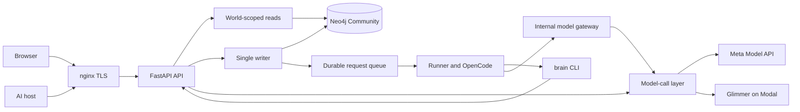

# Architecture

Source baseline: `564cc99b9c8a718f163503cc23227a8f2908fcd1`, recorded on 2026-11-04 after PR #60.
Request17 deployed API `cbcfe574e03880569bfcdb9a9732f79a7ef3daea`.
Its runner and gateway remained on `266d0cf7429eb2ca51bd5bebf9f5785acbcd7b2e`.
These are distinct revisions. [Submission status](submission-status.md) records evidence limits.

## Component map

This map shows component relationships. It does not establish complete runtime acceptance.
The browser uses plain JavaScript. `web/build.py` generates pages and assets in `web/dist`.
The same build generates the [data-flow statement](data-flow.md) from the privacy source.

## Storage, time, and changes

Neo4j Community stores typed items, links, evidence, and time fields. World predicates in
`server/grove/store/query.py` form part of the isolation boundary. Only the writer layer opens
write transactions. It validates changes and produces receipts from post-commit reads.
A queued request does not mean a saved result.

Corrections preserve prior values. History and restore use the D3 writer contract. Truth-clock
checks distinguish source timestamps, scheduled events, and verified claims. A source timestamp
does not prove an event occurred. The ontology floor, bounded consequences, belief transitions,
extraction, and cleanup each have source components with their own evidence and open limits.

Read the [store map](store-map.md), [writer API](../server/grove/writer/README.md),
[consequences](cascade.md), [beliefs](beliefs.md), and [extraction](extraction.md).
Full D14 physical/runtime restore acceptance and complete general D7 reads remain open.
Published authority and worker components do not by themselves activate those services.

## Browser, identity, and MCP

Browser sessions bind access to an account's world. Google and email-code sign-in use real
authentication. OAuth provides scoped grants, PKCE, dynamic registration, consent, refresh,
and revocation. The anonymous root redirects to `/login`; that route also exposes signup.
See [sign-in](signin.md) and [hosts](hosts.md).

The general registry still has `DEFAULT_TOOLS = ()`. A separate authority-checked pair exposes
restricted Cedar `store` and `recall` for prepared synthetic data. The rehearsal uses recall
only. General store/read acceptance does not follow from this pair. Current owner login and
Muse acceptance remain **NOT RUN**. The source refuses mixed read/write MCP batches.

The browser contains the approved pre-event presentation assets and subsequent API integration.
Worker status has a [recorded API contract](worker-activity.md). A toggle or status record does
not prove complete worker execution. The UI repair in PR #60 is published source in this baseline.
It is not deployed in Request17; the next API deployment is not yet executed.
Its source checks do not prove deployed acceptance. Full responsive, control, and first-load
transfer acceptance remain open.
Disabled or disclosed controls still require implementation where the feature scope requires them.

## Sources and materials

PR #58 changes ordinary authenticated ChatGPT/Claude JSON and ZIP uploads to a fresh mandatory
screening policy. It removes the exact-Lumen-only fallback without bypassing screening.
It is present in this source baseline and absent from the recorded Request17 deployment.
An accepted upload retains screened Sources, Episodes, and receipts; it does not create graph
Items or links. The prepared graph is a separate dataset. See [ingest](ingest.md).

Calendar and Git have read-only connector source and revocation rules. Actual configured
provider consent remains separate acceptance. [Pipedream](pipedream.md) imports no content.
PR #59 adds corrected account status, public catalog metadata, and confirmed account-scoped
disconnection. That source is not deployed in Request17. A connected badge proves no import.

Internal document, WhatsApp, image, and audio parsers exist. The separate unpublished file/note
candidate `b4b804acf94250c2092f2e3c7623d6e79ee8bb59` adds screened material storage and note dispatch,
but it is not part of this baseline. Files report `held_provenance` and create no file Request.
The candidate requires separate migration `0019_material_revisions.cypher` and release integration.
Typed-file graph admission remains separate work. Parser tests do not prove durable retention,
live extraction, or complete material acceptance. See [media](ingest-media.md),
[WhatsApp](ingest-whatsapp.md), and [audio](ingest-audio.md).

## Models and operations

The runner selects work and issues a world-bound token to OpenCode. Its agents use the `brain`
CLI rather than direct database access. Command validation and OpenCode permissions restrict
execution. nginx excludes the internal API from public access. See [runner](runner.md).

The model-call layer records provider usage and applies job policies. Spark uses Meta Responses
for direct calls; the OpenCode gateway uses Chat Completions. Glimmer runs on Modal.
The gateway enforces a daily ceiling; concurrent calls can exceed it before usage records arrive.
Modal idle costs and lost usage rows after process failure remain measurement limits.
See [models](models.md).

[Deployment](deploy.md) uses separate API, runner, and gateway services. Backups use offline
Neo4j dumps. Request17 verifies an API-only release and preserves the other service revisions.
Health and synthetic backend results do not certify owner login, Muse, live provider consent,
complete worker behavior, or complete erasure. No new runtime checks ran for this document refresh.
